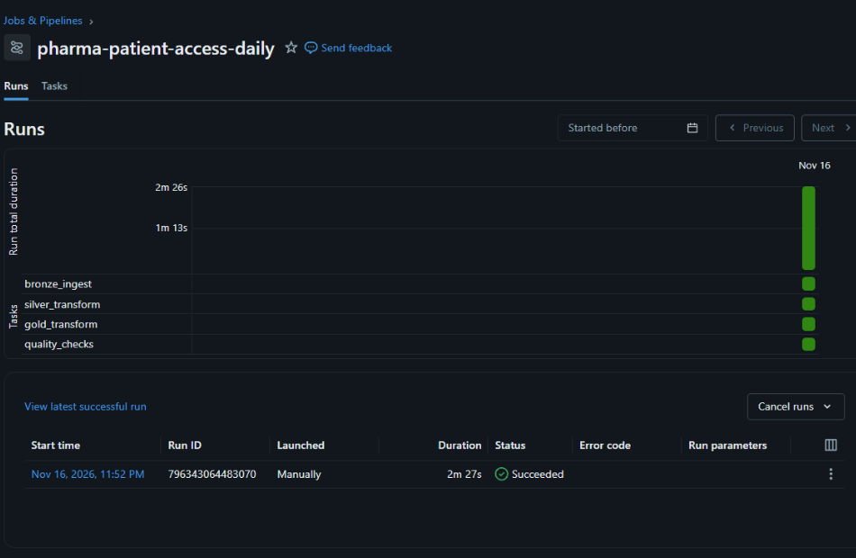
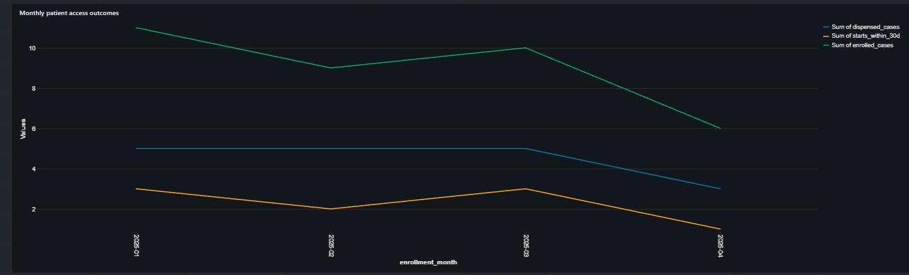
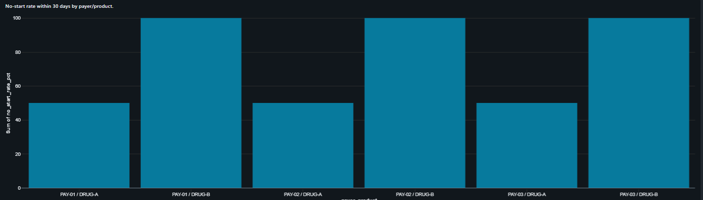
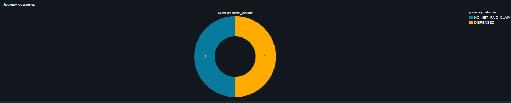

# Pharma Patient Access & Commercial Analytics Lakehouse

[View the project portfolio case study](https://eede-narasimhanag.github.io/pharma-patient-access-lakehouse/) ·
[Browse the source repository](https://github.com/eede-narasimhanag/pharma-patient-access-lakehouse)

A reproducible local and Databricks analytics-engineering project that turns fictional Rx claims, payer formulary, HUB,
and specialty pharmacy source files into quality-checked Silver tables, dimensional Gold facts, and patient-access metrics.

> **Synthetic data only.** Every patient, payer, product, claim, and event is fictional. Product labels and codes are
> invented. This is not a real pharma dataset, a clinical tool, a compliance certification, or a claim about actual
> patient access. No real PII or PHI is used.

## What this first version demonstrates

- Four source feeds with distinct grains: Rx transactions, effective-dated formulary rows, HUB events, and SP fills.
- Bronze tables retain source fields as text; Silver applies typing, standardization, deduplication, and quarantine.
- SQL builds Gold dimensions, transaction/event/fill facts, a one-row-per-HUB-case mart, and monthly access metrics.
- Reconciliation checks surface duplicate claim deliveries, malformed rows, unmatched reversals, and unmatched fills.
- A deterministic generator injects duplicate, rejected, reversed, delayed-start, malformed, and orphan records.
- SQLite and the Python standard library make the end-to-end demo runnable locally without cloud credentials.

## Databricks Free Edition run (verified)

Databricks notebook sources are in [`databricks/notebooks/`](databricks/notebooks/); reusable dashboard SQL is in
[`databricks/sql/dashboard_datasets.sql`](databricks/sql/dashboard_datasets.sql). The notebooks were run in a personal
Databricks Free Edition workspace using serverless compute, Unity Catalog Volumes, Auto Loader, and Delta tables.

The `pharma-patient-access-daily` Job completed all four tasks (Bronze, Silver, Gold, quality checks) successfully in
about **2 minutes 27 seconds** on the 36-case generated fixture.

| Layer / check | Verified result |
|---|---:|
| Bronze Rx / formulary / HUB / SP rows | 56 / 6 / 108 / 19 |
| Silver Rx / formulary / HUB / SP rows | 46 / 6 / 108 / 19 |
| Silver quarantine | 10 rows: 9 duplicate Rx deliveries and 1 malformed Rx date |
| Gold patient-access cases / monthly groups | 36 / 24 |
| Gold unmatched SP fills | 1 deliberately injected orphan |
| Quality checks | 7 `PASS`, 2 expected `REVIEW` (unmatched reversal and orphan fill) |

A native Databricks dashboard was created and published in the workspace with monthly outcomes, payer/product
comparison, and journey-status visuals. It remains restricted to workspace users with access; it is not publicly
published. Chart and workflow captures are included below; the dashboard definition itself remains in the workspace.

### Successful Databricks Job run

The screenshot shows the successful four-task workflow; workspace account details are cropped out.



### Databricks dashboard charts

**Monthly patient-access outcomes**



**30-day no-start rate by payer and product**



**Synthetic patient journey outcomes**



## Run locally

Requires Python 3.11+.

```powershell
python -m venv .venv
.\.venv\Scripts\Activate.ps1
python -m pip install -r requirements-dev.txt
python scripts\run_demo.py
pytest -q
```

The run creates CSV inputs and `patient_access.db` under `data/generated/`. Generated files and the local database are
ignored by Git. It also writes `data/generated/dashboard.html`, a self-contained dashboard showing access metrics and
data-quality exceptions. To choose another location or number of cases:

```powershell
python scripts\run_demo.py --output .\data\sample --cases 60
```

## Data flow

```text
Synthetic CSV sources
        |
        v
Bronze (raw text + source file)
        |
        v
Silver (typed records + quarantine)
        |
        v
Gold dimensions / transaction, event and fill facts
        |
        +--> Patient access case mart
        +--> Monthly enrollment / start / dispense metrics
        +--> Data quality and reconciliation checks
```

See [source-to-target mapping](docs/source_to_target.md) and [metric glossary](docs/metric_glossary.md) for table grains,
joins, and precise metric definitions.

## Deliberate limitations

- The Databricks run was a personal Free Edition demonstration, not a production deployment or a guarantee of
  production-scale performance.
- The HTML dashboard is a lightweight local view, not a Power BI or Tableau dashboard or semantic layer.
- The Databricks dashboard lives in the workspace; the repository contains reusable SQL datasets and chart screenshots,
  not an exported dashboard definition.
- Case matching uses synthetic patient/product IDs and simple date logic. No real-world identity resolution is represented.
- The data model is intentionally small: it is not a full commercial data warehouse and does not model all claims
  adjudication, payer contracts, HUB workflows, or specialty pharmacy operations.
- Governance is demonstrated through data minimization, synthetic identifiers, and explicit limitations—not through
  a HIPAA or regulatory compliance claim.
